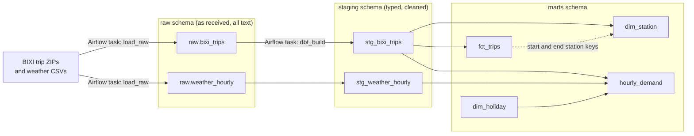

# BIXI x Weather Data Platform

A local data pipeline that loads Montreal BIXI bike-share trips (2025 to August 2026) and hourly weather observations into PostgreSQL, models them with dbt into a small star schema (a trip fact table, station and holiday dimensions, and an hourly demand table), and orchestrates the whole run with Airflow.

## Architecture



Everything runs in Docker: a PostgreSQL 16 container (`bixi-postgres`, port 5434) and an Airflow container (`bixi-airflow`, port 8080) that runs the DAG `bixi_pipeline`: `load_raw` then `dbt_build`.

## Results

- `stg_bixi_trips`: 23,351,725 trips kept (durations between 1 minute and 24 hours).
- `stg_weather_hourly`: 14,569 hourly observations.
- `hourly_demand`: 14,592 hours, one row per hour, joined on the UTC hour with a `has_weather` flag (23 hours have no weather observation) and an `is_holiday` flag (13 Quebec holidays, 312 hours).
- `dim_station`: 1,558 stations, one row per normalized station name, with one coordinate each. 51 groups of spelling variants (104 raw names, for example `10e avenue / Masson` and `10e Avenue / Masson`) are merged into one station each.
- `fct_trips`: all 23,351,725 trips, with a start and an end station key. 3 trips have no start station name and 4 have no end station name; they are kept with an empty key.
- `dbt build`: 6 models and 10 data tests pass (unique and not null on keys, not null on `trips` and `has_weather`, and relationships from `fct_trips` to `dim_station` for both station keys).

## Design choices

- **Raw data is kept as received** (text columns, source file recorded), so every cleaning rule lives in dbt and can be audited.
- **Reloads are idempotent**: the loader deletes a file's rows before reloading it, so re-running never creates duplicates.
- **Join on the UTC hour** to avoid daylight saving time ambiguity; local time is derived for analysis.
- **Missing weather is flagged, not dropped**: trips are never lost, `has_weather` marks hours without a measurement.
- **One coordinate per station**: the same station name appears with slightly different coordinates in the trip data, so `dim_station` keeps the most frequent one. Most stations vary by less than 100 m; the largest spread is about 336 m for a handful of stations.
- **Station keys are an MD5 hash of a normalized station name** (lowercased, punctuation and spaces removed, in the `station_key` dbt macro), so spelling variants collapse into one station, and the fact table and the dimension can still be built independently and join. All merged variants were less than 50 m apart (44 m at most), and the most frequent spelling is kept as the display name.
- The earlier SQL scripts in `sql/` produced the same staging and hourly tables and were used to validate the dbt models (same row counts and trip totals).

## Getting the data

The raw files are not stored in the repository. Put them in `data/raw/`:

- **BIXI trips**: the yearly open-data ZIP files from [BIXI Montreal open data](https://bixi.com/fr/donnees-ouvertes/) (one ZIP per year, each containing one CSV). Keep the ZIPs as downloaded, `load_raw.py` reads them directly.
- **Hourly weather**: one CSV per year named `weather_<year>.csv` (for example `weather_2025.csv`, `weather_2026.csv`). They are produced by the extraction script of the companion project [bixi-weather-demand](https://github.com/NadaAf25/bixi-weather-demand): run `src/01_extract_weather.py --years 2025 2026` there (see `--help` for the other options), then copy the CSV files into this project's `data/raw/`.

## Run it

Requirements: Docker Desktop and the raw files in `data/raw/` (see above).

```bash
docker compose up -d --build
psql -h localhost -p 5434 -U bixi -d bixi -f sql/01_schema_raw.sql
```

Then open Airflow at http://localhost:8080, open the DAG `bixi_pipeline` and click Trigger. When both tasks are green, the result is in the `marts` schema. A full run (reloading about 23 million trips, then building the six models and running the tests) took about 34 minutes on a laptop: about 15 for `load_raw` and 19 for `dbt_build`, of which `fct_trips` alone takes about 9.

To run the steps by hand instead (Python 3 required):

```bash
python -m venv .venv
pip install dbt-postgres psycopg2-binary
python ingestion/load_raw.py
cd dbt
dbt build
```

The dbt connection is defined in `dbt/profiles.yml` (localhost:5434, user `bixi`). The default password `bixi` and the Airflow setup without login are for a local demo only; set `DBT_PASSWORD` to override the database password, and never expose these services on a public network.

## Data sources

- BIXI Montreal open trip data ([bixi.com/fr/donnees-ouvertes](https://bixi.com/fr/donnees-ouvertes/)).
- Hourly weather observations from Environment and Climate Change Canada.

Check each provider's terms of use before reusing the data.