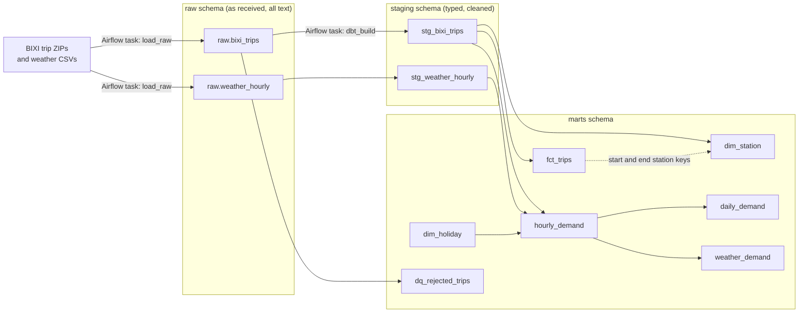
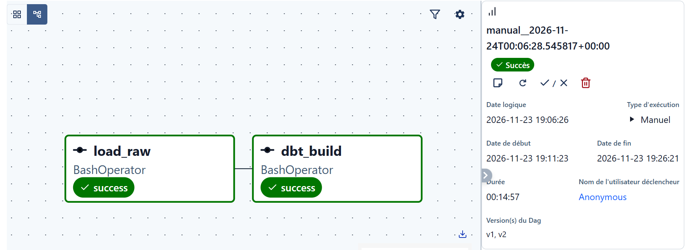

# BIXI x Weather Data Platform


A local data pipeline that loads Montreal BIXI bike-share trips (2025 to August 2026) and hourly weather observations into PostgreSQL, models them with dbt into a small star schema (a trip fact table, station and holiday dimensions, an hourly demand table, a daily demand table with a rolling average and a year-over-year comparison, and a weather and demand summary) with a data quality report on rejected trips, and orchestrates the whole run with Airflow.

## Architecture



Everything runs in Docker: a PostgreSQL 16 container (`bixi-postgres`, port 5434) and an Airflow container (`bixi-airflow`, port 8080) that runs the DAG `bixi_pipeline`: `load_raw` then `dbt_build`.

## Results

- `stg_bixi_trips`: 23,351,725 trips kept (durations between 1 minute and 24 hours).
- `stg_weather_hourly`: 14,569 hourly observations.
- `hourly_demand`: 14,592 hours, one row per hour, joined on the UTC hour with a `has_weather` flag (23 hours have no weather observation) and an `is_holiday` flag (13 Quebec holidays, 312 hours).
- `daily_demand`: 608 complete days (1 January 2025 to 31 August 2026) built from `hourly_demand`, with a 7-day rolling average (window function) and a comparison with the same weekday 364 days earlier (CTEs and a self-join).
- `weather_demand`: 24 rows, average daytime trips per hour by 5 °C band and rain flag, with the number of observed hours per cell.
- `dim_station`: 1,558 stations, one row per normalized station name, with one coordinate each. 51 groups of spelling variants (104 raw names, for example `10e avenue / Masson` and `10e Avenue / Masson`) are merged into one station each.
- `fct_trips`: all 23,351,725 trips, with a start and an end station key. 3 trips have no start station name and 4 have no end station name; they are kept with an empty key. The table is incremental, sorted by `start_hour_utc` and indexed on it (see Design choices and Query performance).
- `dq_rejected_trips`: of 23,753,414 raw trips, 401,689 (1.69%) are excluded from staging: 298,193 shorter than 1 minute, 96,219 with no end time and 7,277 longer than 24 hours. The rate is stable across the two source files (about 1.7% each).
- `dbt build`: 9 models and 19 data tests pass (unique and not null on keys, not null on `trips` and `has_weather`, relationships from `fct_trips` to `dim_station` for both station keys, two data quality checks on rejected trips, unique and not null checks plus a reconciliation of daily and hourly trip totals on `daily_demand`, and not null checks plus a reconciliation of observed hours against `hourly_demand` on `weather_demand`).
- GitHub Actions runs `dbt parse` on every push to `main` and on pull requests, to catch SQL, Jinja, YAML and `ref` errors early.

## Design choices

- **Raw data is kept as received** (text columns, source file recorded), so every cleaning rule lives in dbt and can be audited.
- **Reloads are idempotent**: the loader deletes a file's rows before reloading it, so re-running never creates duplicates.
- **Join on the UTC hour** to avoid daylight saving time ambiguity; local time is derived for analysis.
- **Missing weather is flagged, not dropped**: trips are never lost, `has_weather` marks hours without a measurement.
- **Rejected trips are counted, not hidden**: `dq_rejected_trips` reports every excluded trip by source file and reason. One test checks that its kept count equals `stg_bixi_trips`, and another fails the run if a source file rejects more than 5% of its trips.
- **Year-over-year compares the same weekday**: `daily_demand` looks back 364 days (exactly 52 weeks), so a Saturday is compared with a Saturday. Only complete days (23 to 25 hours, which covers the two daylight saving days) are kept, and a test checks that daily totals equal hourly totals, so no trip is lost.
- **One coordinate per station**: the same station name appears with slightly different coordinates in the trip data, so `dim_station` keeps the most frequent one. Most stations vary by less than 100 m; the largest spread is about 336 m for a handful of stations.
- **No slowly changing dimension for stations**: I compared each station's average start position in 2025 and 2026 (stations with more than 100 trips in both years). The ten largest shifts are 47 to 132 m, and only one (`McNamara / St-Martin O`, 132 m) exceeds 100 m, which is the same order as the coordinate noise described above. With no clear sign of stations being moved, `dim_station` keeps one row per station instead of a history of positions. This check only covers coordinates at the station-name level; it does not test name changes.
- **Station keys are an MD5 hash of a normalized station name** (lowercased, punctuation and spaces removed, in the `station_key` dbt macro), so spelling variants collapse into one station, and the fact table and the dimension can still be built independently and join. All merged variants were less than 50 m apart (44 m at most), and the most frequent spelling is kept as the display name.
- **`fct_trips` is incremental**: a run only inserts trips with a `start_hour_utc` later than the latest one already loaded. Test: after deleting August 2026 (2,239,567 trips), a run restored exactly those rows in 20 s, against 460 to 536 s for a full rebuild, and the total returned to 23,351,725. Limits: trips corrected afterwards in an already loaded period, or a partially loaded hour, are not picked up. Use `dbt run --select fct_trips --full-refresh` to rebuild everything.
- **Airflow retries and timeout**: `load_raw` retries once after 2 minutes, in case of a transient database or disk error. `dbt_build` is not retried, because a failing data test is not transient, and it is stopped after 2 hours. The DAG has run end to end with these settings (both tasks succeeded on the first attempt), but no retry or timeout was actually triggered.
- **Airflow runs on SQLite (known limitation)**: the Airflow container uses `airflow standalone`, which keeps its internal metadata in a SQLite file. During testing the scheduler stopped once with `database is locked`; `docker restart bixi-airflow` brought it back. A sturdier setup would keep the Airflow metadata in the PostgreSQL container, which this project does not do.
- The earlier SQL scripts in `sql/` produced the same staging and hourly tables and were used to validate the dbt models (same row counts and trip totals).

## Query performance

`fct_trips` (23,351,725 rows) is sorted by `start_hour_utc` and indexed on that column, both set in the dbt model. I measured the effect with `EXPLAIN (ANALYZE, BUFFERS)` on a "top 10 start stations" query, for one day (14 July 2026, 73,694 trips) and for one month (July 2026, about 2.3 million trips). Timings depend heavily on what is cached in memory, so the first run after a rebuild (cold) and a later run (warm) are both shown. Each figure is a single run.

| Query | Plan | Cold | Warm |
|---|---|---|---|
| One day | with index | 511 ms | 40 ms |
| One day | index disabled (full scan) | 24,289 ms | 2,384 ms |
| One month | with index | n/a | 2,020 ms |
| One month | index disabled (full scan) | n/a | 1,697 ms |

- **One day**: with the table sorted, the index is about 60 times faster when warm (40 ms against 2.4 s). Even comparing a cold index run with a warm full scan, it is about 5 times faster. Full-scan timings vary a lot (24 s, 35 s, then 2.4 s for the same query), depending on the cache.
- **One month**: the index does not help. With the table cached, the full scan was slightly faster (1.7 s against 2.0 s), a gap within the noise. The planner still chose the index, because its cost estimate was far below the real timing.
- **Sorting matters**: before the table was sorted by date (correlation 0.73 between row order and `start_hour_utc`), the same index gave no gain, even for one day (1.7 s against 1.4 s). After sorting (correlation 1.0), the planner's cost estimate for one day dropped from 165,653 to 2,978.
- **Build time**: rebuilding `fct_trips` took 9.0 minutes before sorting and 7.7 minutes after, so the sort and the index had no visible cost on this machine (one run each).

## Weather and demand

`weather_demand` (24 rows) gives the average trips per hour by 5 °C temperature band and by rain flag (`is_raining` from `hourly_demand`), for daytime hours (7 am to 9 pm) that have a weather observation. It also keeps `hours_observed`, so thin cells are visible.

| Temperature | Dry (trips/hour) | Rain (trips/hour) | Difference |
|---|---|---|---|
| 5 to 10 °C | 1,701 | 1,109 | -35% |
| 10 to 15 °C | 2,616 | 1,507 | -42% |
| 15 to 20 °C | 3,446 | 1,998 | -42% |
| 20 to 25 °C | 4,219 | 2,810 | -33% |

- Rain lowers demand by roughly a third to two fifths in every band with a reasonable number of rainy hours (74 to 163 hours), so the effect is not only a temperature effect.
- Cells with very few rainy hours (1 hour below -20 °C, 9 hours at 25 to 30 °C, none above 30 °C) should not be interpreted.
- This is a descriptive average over 2025 to August 2026, with no control for hour of day, weekday or season. The companion project [bixi-weather-demand](https://github.com/NadaAf25/bixi-weather-demand) models these effects.
- Three tests protect the model: the observed hours per cell must add up to the daytime hours with weather in `hourly_demand` (so no hour is lost or counted twice), and `hours_observed` and `avg_trips_per_hour` must not be null.

## Getting the data

The raw files are not stored in the repository. Put them in `data/raw/`:

- **BIXI trips**: the yearly open-data ZIP files from [BIXI Montreal open data](https://bixi.com/fr/donnees-ouvertes/) (one ZIP per year, each containing one CSV). Keep the ZIPs as downloaded, `load_raw.py` reads them directly.
- **Hourly weather**: one CSV per year named `weather_<year>.csv` (for example `weather_2025.csv`, `weather_2026.csv`). They are produced by the extraction script of the companion project [bixi-weather-demand](https://github.com/NadaAf25/bixi-weather-demand): run `src/01_extract_weather.py --years 2025 2026` there (see `--help` for the other options), then copy the CSV files into this project's `data/raw/`.

## Run it

Requirements: Docker Desktop and the raw files in `data/raw/` (see above).

```bash
docker compose up -d --build
psql -h localhost -p 5434 -U bixi -d bixi -f sql/01_schema_raw.sql
```

Then open Airflow at http://localhost:8080, open the DAG `bixi_pipeline` and click Trigger. When both tasks are green, the result is in the `marts` schema. A full run (reloading about 23 million trips, then building the nine models and running the tests) took 14 min 57 s on a laptop in one measured run: about 8 minutes for `load_raw` and 7 for `dbt_build`, with `fct_trips` built incrementally.



To run the steps by hand instead (Python 3 required):

```bash
python -m venv .venv
pip install dbt-postgres psycopg2-binary
python ingestion/load_raw.py
cd dbt
dbt build
# rebuild fct_trips from scratch (for example after a change of its logic):
dbt run --select fct_trips --full-refresh
```

The dbt connection is defined in `dbt/profiles.yml` (localhost:5434, user `bixi`). The default password `bixi` and the Airflow setup without login are for a local demo only; set `DBT_PASSWORD` to override the database password, and never expose these services on a public network.

## Data sources

- BIXI Montreal open trip data ([bixi.com/fr/donnees-ouvertes](https://bixi.com/fr/donnees-ouvertes/)).
- Hourly weather observations from Environment and Climate Change Canada.

Check each provider's terms of use before reusing the data.
